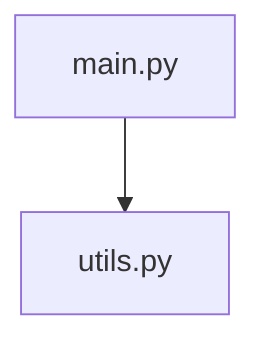

# Project Context & Architecture Guide

> Auto-generated by `context-gen-cli` (Python Edition) for AI agent reasoning.

## Overview
Project workspace rooted at test_fixture.

## Tech Stack
- **Python**

## Directory Structure
```
test_fixture/
├── .gitignore
├── main.py
└── utils.py
```

## Key Files & Entry Points
- **`main.py`**: Main application entry point.
- **`utils.py`**: Utility helper functions.

## Module Dependency Graph

### Entry Points
- `main.py`

### Core Modules & Utilities
- `utils.py`

### Import Relationships (Edges)

